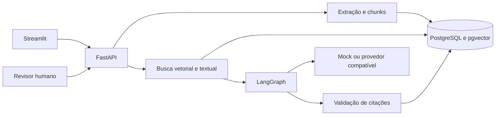

# GenAI Operations Copilot

Copiloto para a **Rota Nuvem**, marketplace fictício de entregas. Operadores podem localizar regras, consultar a evidência original e registrar a revisão de solicitações críticas. O projeto de Maria Antônia demonstra ingestão, recuperação híbrida, orquestração e avaliação reproduzível de RAG.



## Executar com Docker

Requisitos: Docker Compose e acesso aos registros de imagens. Copie `.env.example` para `.env` com `cp .env.example .env` ou `Copy-Item .env.example .env` no PowerShell. Defina uma chave própria em `APPROVAL_KEY` se for demonstrar a decisão do revisor.

```sh
docker compose up --build -d --wait
docker compose exec api .venv/bin/python -m scripts.seed
docker compose exec api .venv/bin/python -m app.evaluation.run
```

Dentro do container, a API usa a porta 8000. A interface está em http://localhost:8501 e o OpenAPI em http://localhost:8000/docs. Os contêineres da API e da interface publicam portas apenas no loopback. A migração executa na inicialização da API.

## Executar sem Docker no PowerShell

```powershell
uv sync --locked --group ui
$env:DATABASE_URL = "sqlite:///./demo.db"
uv run alembic upgrade head
uv run uvicorn app.api:app
```

Em terminais separados, execute `uv run python -m scripts.seed`, `uv run python -m app.evaluation.run` e `uv run streamlit run streamlit_app/main.py`. Para usar PostgreSQL nativo, configure `DATABASE_URL` para um banco com permissão para habilitar pgvector e execute a mesma migração. O SQLite usa a implementação local de recuperação e permite testar os fluxos sem infraestrutura.

## API e uso

```sh
curl -X POST http://localhost:8000/chat/ask \
  -H 'Content-Type: application/json' \
  -d '{"question":"Quando registrar incidente por atraso crítico?","category":"entregas"}'
```

A resposta inclui `answer`, `status`, `citations`, `retrieved`, `trace`, `usage`, `latency_ms`, `id` e `session_id`. Exemplo de conteúdo esperado para a consulta, após semear o banco:

```json
{
  "status": "answered",
  "answer": "[1] Atraso crítico exige registrar incidente após 45 minutos."
}
```

Envie `session_id` nas consultas da mesma sessão e use `GET /chat/sessions/{id}` para recuperar o histórico. Passe `task` para escolher `search`, `compare`, `incident`, `contradictions`, `next_steps` ou `approval`. Para decidir uma solicitação pendente, envie `POST /approvals/{id}` com `{"approve":true}` e o cabeçalho `X-Approval-Key`. Para feedback, envie `POST /feedback` com `{"turn_id":"ID_DA_RESPOSTA","positive":true}`.

## Configuração de modelos

| Variável | Uso |
| --- | --- |
| `PROVIDER` | `mock` por padrão, `openai`, `gemini` ou `local` |
| `MODEL` | Nome do modelo configurado no provedor |
| `API_KEY` | Token para OpenAI ou Gemini |
| `MODEL_URL` | URL-base do servidor local compatível com Chat Completions, incluindo `/v1` quando exigido |
| `EMBEDDING_URL`, `EMBEDDING_MODEL`, `EMBEDDING_API_KEY` | Endpoint completo de embeddings compatível com OpenAI, modelo de 384 dimensões e token opcional |
| `TIMEOUT` | Prazo de chamadas HTTP em segundos |
| `INPUT_USD_PER_MILLION`, `OUTPUT_USD_PER_MILLION` | Tarifas inseridas pelo operador para estimar custo |
| `APPROVAL_KEY` | Chave do revisor, vazia desabilita decisões |
| `MAX_UPLOAD_BYTES` | Limite de leitura do arquivo, 5 MiB por padrão |
| `API_URL` | Endereço da API para a interface, o seed e a avaliação |

Em Compose, use um endereço acessível ao contêiner para conectar um modelo local. O modo mock não chama modelos externos e registra zero tokens faturáveis.

## Arquitetura, segurança e avaliação

Veja [arquitetura](docs/architecture.md), [roteiro da demo](docs/demo.md) e [contribuição](CONTRIBUTING.md). O conjunto de avaliação inclui 28 perguntas com resposta de referência, uma pergunta sem evidência e um ataque explícito. O relatório JSON separa recuperação, presença de fontes, acerto, fidelidade literal, custo e latência. A fidelidade literal verifica se a citação aparece no trecho e o acerto exige a referência e a expressão esperadas. Os casos sintéticos verificam regressões, com alcance limitado para medir a qualidade de modelos reais.

### Resultado medido

Execução HTTP local com FastAPI, SQLite e modo mock. O [relatório por caso](docs/evaluation-sqlite-mock.json) registra 30 consultas, das quais 28 têm resposta de referência.

| Métrica | Resultado |
| --- | ---: |
| Hit rate@5 e Recall@5 | 100% |
| Respostas esperadas com citação | 28/28 |
| Fidelidade literal entre respostas emitidas | 100% |
| Respostas sem evidência esperada | 0/30 |
| Abstenção e teste explícito de injeção | 2/2 |
| Latência média e p95 | 10,20 ms e 12,54 ms |
| Tokens faturáveis e custo estimado | 0 e US$ 0,00 |

Na suíte local com SQLite, 15 testes passaram com 87% de cobertura de código. Ruff e mypy passaram. A interface foi exercitada contra a API local com consulta, citação, histórico e feedback.

No Docker Compose, com PostgreSQL 16.15 e pgvector 0.8.6, a avaliação em modo mock registrou 100% de hit rate@5 e Recall@5, 28/28 respostas esperadas com citação, 2/2 casos de abstenção e injeção e custo estimado de US$ 0,00. A latência média foi de 8,19 ms e o p95 foi de 16,96 ms. Veja o [relatório do Compose](docs/evaluation-postgres16-mock.json).

A avaliação usa procedimentos sintéticos e perguntas curtas. Ela cobre regressões do modo mock e não mede a qualidade de um provedor generativo ou de um modelo semântico externo.

## English summary

An operations RAG copilot for a fictional delivery marketplace. It ingests Portuguese procedures, retrieves evidence with PostgreSQL full-text search and pgvector, validates extractive citations and records human approval decisions. The deterministic mock supports offline evaluation and CI without paid API access.

MIT · Maria Antônia
